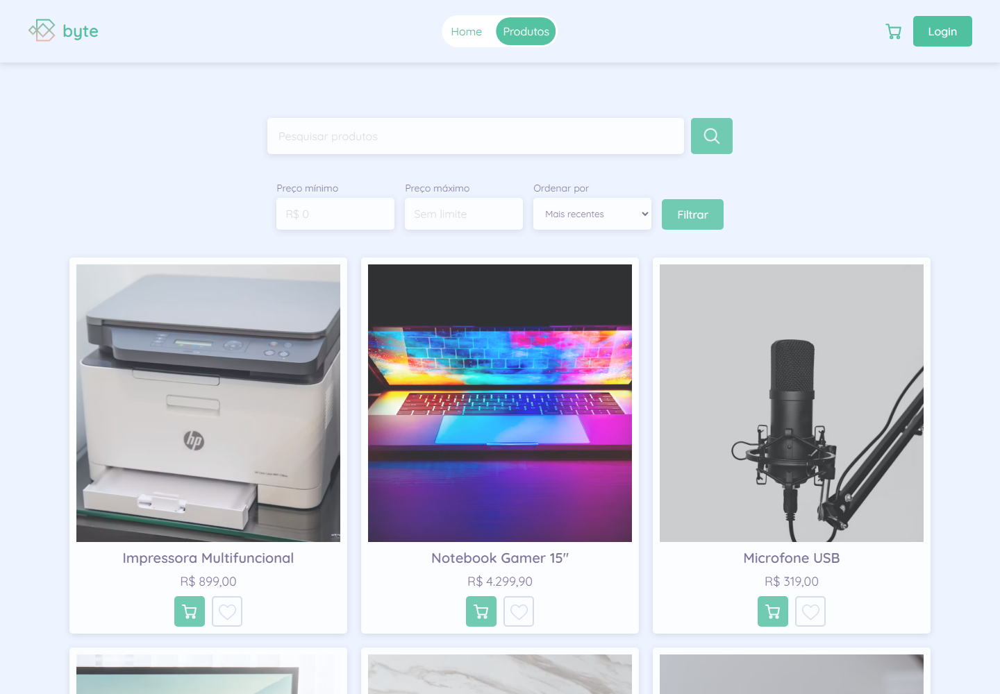
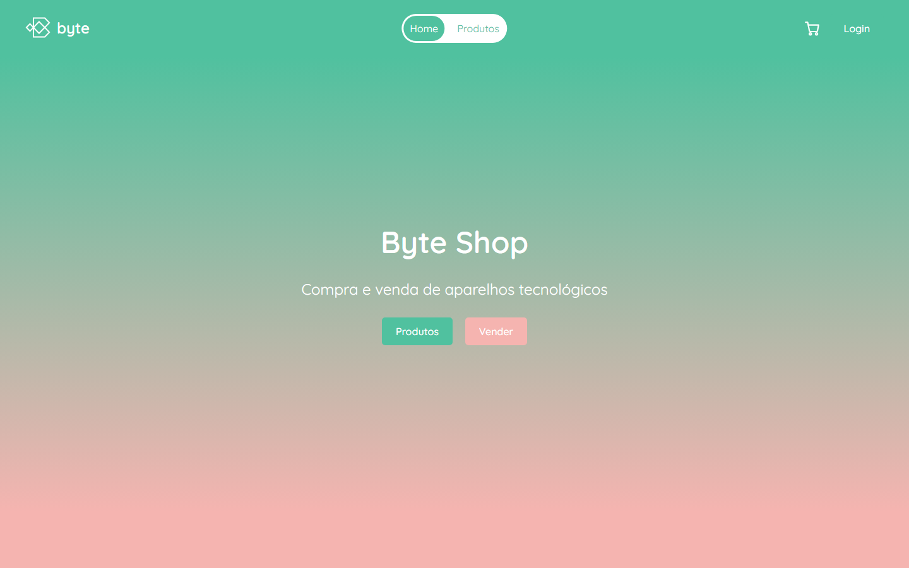
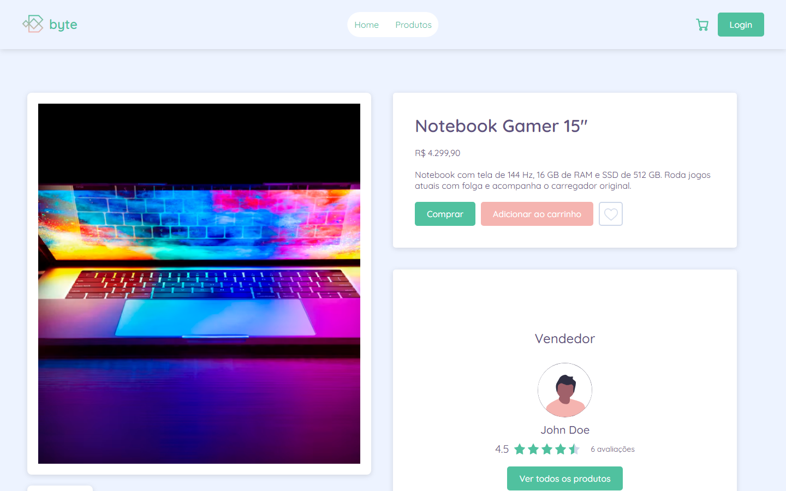
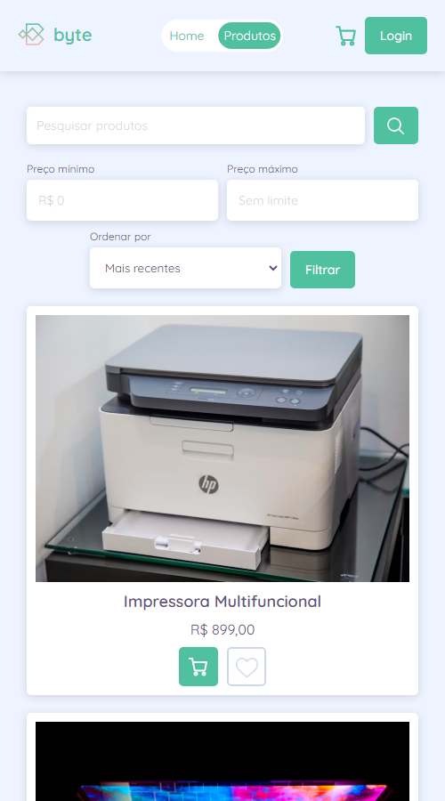

# Byte Shop

Marketplace de aparelhos tecnológicos: qualquer pessoa pode anunciar, comprar, favoritar produtos e avaliar vendedores.

**[Ver o site no ar](https://byte-shop-phi.vercel.app)**



| Início | Produto | Celular |
|---|---|---|
|  |  |  |

O projeto nasceu do Ranek, do curso de Vue.js da [Origamid](https://www.origamid.com/), e foi reescrito e ampliado depois disso.

## Funcionalidades

O Byte Shop é um marketplace completo, onde cada pessoa pode tanto comprar quanto vender. Hoje dá pra:

- Buscar produtos, filtrar por preço e ordenar a lista. Como tudo isso fica salvo na URL, também dá pra compartilhar o link de uma busca.
- Adicionar produtos ao carrinho mesmo sem estar logado, e o carrinho continua lá depois do login.
- Comprar um produto só ou todos os itens do carrinho de uma vez.
- Criar uma conta, recuperar a senha e preencher o endereço automaticamente pelo CEP.
- Anunciar produtos e acompanhar as vendas em um painel com gráfico por mês e filtro de período.
- Favoritar produtos, ver o histórico de pedidos e avaliar os vendedores depois da compra.

## Stack

| Tecnologia | Para quê |
|---|---|
| [Vue 3](https://vuejs.org/) | Interface, com Composition API e `<script setup>` |
| [Pinia](https://pinia.vuejs.org/) | Sessão, favoritos, carrinho e alertas |
| [Vue Router](https://router.vuejs.org/) | Rotas com code splitting e proteção de páginas privadas |
| [Supabase](https://supabase.com/) | Postgres, autenticação e regras de acesso (RLS) |
| [vee-validate](https://vee-validate.logaretm.com/) + [yup](https://github.com/jquense/yup) | Validação de formulários |
| [Sass](https://sass-lang.com/) | Estilos com escopo por componente |
| [GSAP](https://gsap.com/) | Animações das listas |
| [Vitest](https://vitest.dev/) + [ESLint](https://eslint.org/) | Testes e lint, rodando no GitHub Actions |

## Decisões técnicas

Esse projeto começou como um exercício de curso e fui ampliando até virar um marketplace completo. Um dos meus maiores focos foi deixar as regras importantes no banco de dados, já que tudo que fica no navegador pode ser alterado por quem está usando o site. Essas são algumas decisões que tomei e gosto bastante:

### Compra pelo banco de dados

A compra é feita por uma função no banco, que marca o produto como vendido e cria o pedido na mesma transação. O preço, o comprador e o endereço vêm do próprio banco, o que garante que ninguém altere esses dados pelo navegador, além de impedir que duas pessoas comprem o mesmo produto ([02-purchase-rpc.sql](supabase/02-purchase-rpc.sql)).

### Permissões

Com Row Level Security e permissões por coluna, cada usuário só consegue ver e alterar o que é dele. Na vitrine eu uso uma view que mostra apenas o nome e a foto do vendedor, assim o email e o endereço de ninguém ficam expostos ([05-rls-policies.sql](supabase/05-rls-policies.sql), [03-public-profiles.sql](supabase/03-public-profiles.sql)).

### Sessão do usuário

Quem define se o usuário está logado é a sessão do Supabase, e a store só reflete esse estado. O router espera a sessão ser restaurada antes de liberar uma página, então recarregar uma página privada não manda ninguém pro login sem necessidade ([UserState.js](src/stores/UserState.js), [router](src/router/index.js)).

### Manter o site no ar

Como o Supabase pausa projetos gratuitos que ficam sem atividade, criei um workflow no GitHub Actions que faz uma consulta no banco a cada 6 horas ([keep-supabase-alive.yml](.github/workflows/keep-supabase-alive.yml)).

## Como rodar

Precisa de Node 20.19 ou mais novo e de um projeto no Supabase.

```bash
git clone https://github.com/Beawnk/byte-shop.git
```

```bash
cd byte-shop
```

```bash
npm install
```

Crie um arquivo `.env` na raiz com os dados do seu projeto (Project Settings > API Keys). Use a chave **publishable**, nunca a secret: tudo que começa com `VITE_` vai junto no JavaScript entregue ao navegador.

```
VITE_SUPABASE_URL=https://seu-projeto.supabase.co
VITE_SUPABASE_ANON_KEY=sb_publishable_sua_chave
```

Depois rode:

```bash
npm run dev
```

| Comando | O que faz |
|---|---|
| `npm run dev` | Servidor de desenvolvimento |
| `npm run build` | Build de produção |
| `npm run lint` | ESLint |
| `npm test` | Testes com Vitest |
| `npm run format` | Formata `src/` com Prettier |

## Banco de dados

Os scripts em [`supabase/`](supabase) são alterações sobre as tabelas já existentes (`users`, `products`, `orders`, `reviews` e `favorites`). A criação inicial dessas tabelas não está versionada: use [00-inspect.sql](supabase/00-inspect.sql) para ver o schema de um projeto em funcionamento.

Em um projeto com as tabelas prontas, rode no SQL Editor, nesta ordem: `02`, `03`, `04`, depois `01` e `05`. Os dois últimos bloqueiam o fluxo antigo, então entram junto com o deploy do front.

## Licença e créditos

Projeto de portfólio de [Bianca Sineleck](https://github.com/Beawnk), sem licença de uso definida. Parte das fotos de produtos vem do [Unsplash](https://unsplash.com).
